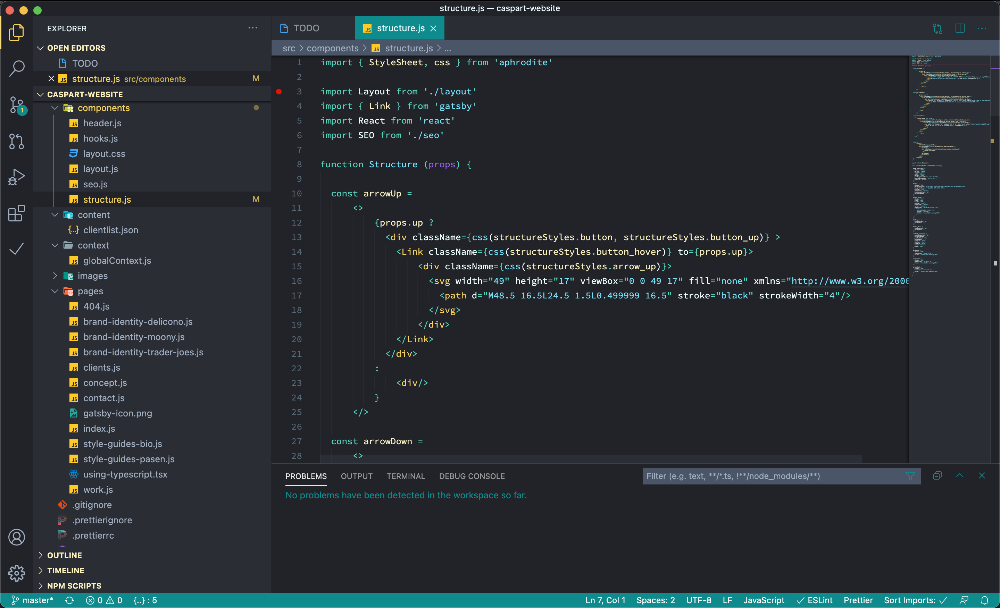
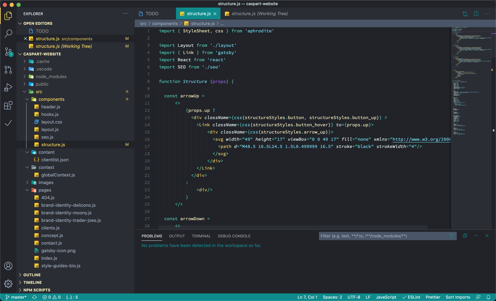

# Motion Haleness

A modern dark color theme for Visual Studio Code. Motion Haleness combines a balanced, high-contrast palette with full semantic highlighting support, and keeps your code readable even in diffs and Source Control.

## Features

- High-contrast dark palette tuned for long coding sessions
- Readable comments, including inside diff and Source Control views
- Semantic highlighting for TypeScript and JavaScript
- Themed terminal with matching ANSI colors
- Bracket pair, editor widget and peek view colors that match the theme
- Two variants: **Motion Haleness** and **Motion Haleness Italic**

## Works with coding agents

Motion Haleness pairs nicely with coding agents that run in your terminal.

### Kilo Code

Works out of the box — Kilo Code renders inside VS Code and automatically uses the active color theme.

### Codex CLI

Motion Haleness syntax highlighting for code blocks and diffs:

1. Copy `coding-agents/codex/motion-haleness.tmTheme` to `~/.codex/themes/`
2. Run `codex` and select it via `/theme`, or set it in `~/.codex/config.toml`:

   ```toml
   [tui]
   theme = "motion-haleness"
   ```

Codex renders its main UI with your terminal's palette, not the theme. For a colorful, high-contrast Codex UI, apply the Motion Haleness ANSI colors from the theme to your terminal profile (the same palette used by the VS Code terminal).

### Claude Code

Requires Claude Code 2.1.118 or later:

1. Copy `coding-agents/claude-code/motion-haleness.json` to `~/.claude/themes/`
2. Run `claude` and select it via `/theme` (appears as `custom:motion-haleness`), or set `"theme": "custom:motion-haleness"` in `~/.claude/settings.json`

## Fonts

Motion Haleness ships two fonts from Google, bundled in `assets/fonts/` as variable fonts (SIL Open Font License 1.1):

- **Google Sans Code** — monospace, used for the editor and integrated terminal (default weight 300; variable 300–800)
- **Google Sans Flex** — proportional, used for the Markdown preview

To use them, install the fonts on your system:

- **macOS:** run `./scripts/install-fonts.sh`, or copy the `.ttf` files from `assets/fonts/` to `~/Library/Fonts`
- **Other platforms:** install the `.ttf` files from `assets/fonts/` with your platform's font manager

Restart VS Code after installing. The defaults set `"Google Sans Code"` for `editor.fontFamily` and `terminal.integrated.fontFamily`, and `"Google Sans Flex"` for `markdown.preview.fontFamily` — you can always override these in your own settings.

## Screenshots

### Motion Haleness


### Motion Haleness Italic


## Installation

1. Install [Visual Studio Code](https://code.visualstudio.com/)
2. Open the **Extensions** view (`Ctrl+Shift+X`)
3. Search for **Motion Haleness**
4. Click **Install**
5. Open the Command Palette (`Ctrl+Shift+P`) and run **Preferences: Color Theme**
6. Select **Motion Haleness** or **Motion Haleness Italic**

## Feedback

Found a bug or have a suggestion? Please [file an issue](https://github.com/erole-attack/motion-haleness-vscode-theme/issues). Feedback is very welcome.
