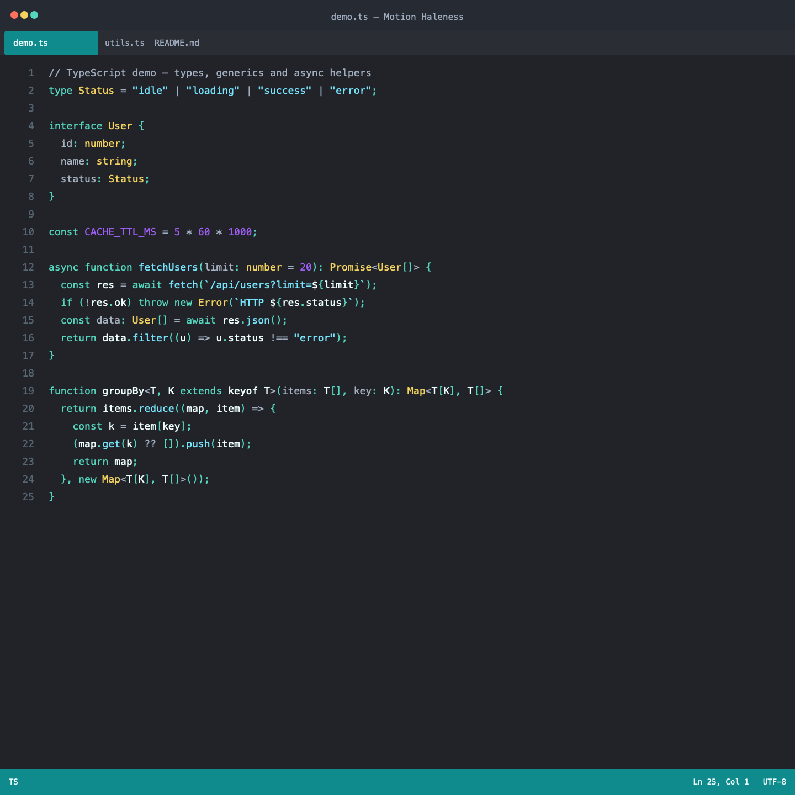
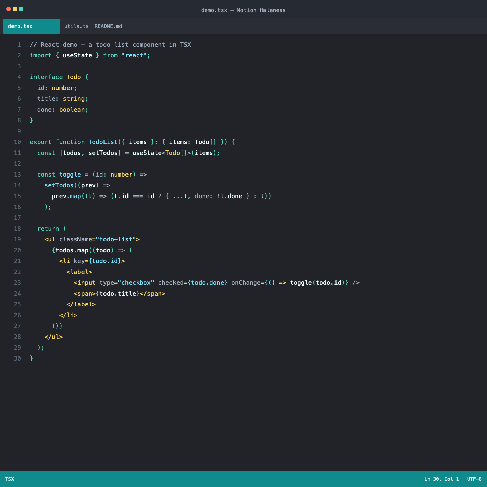
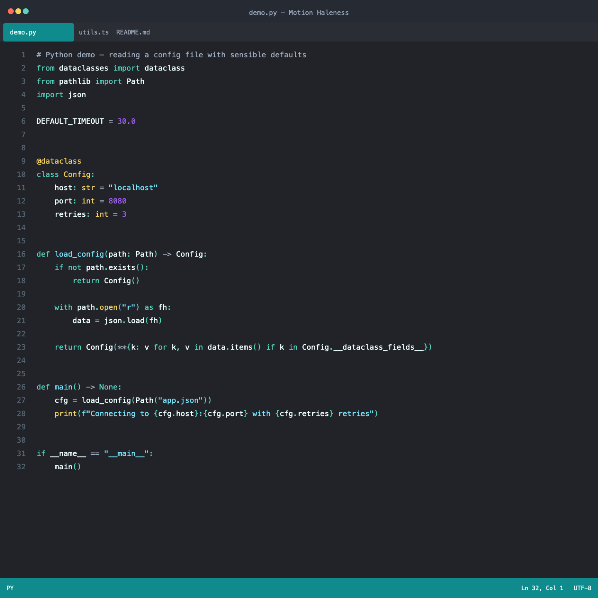
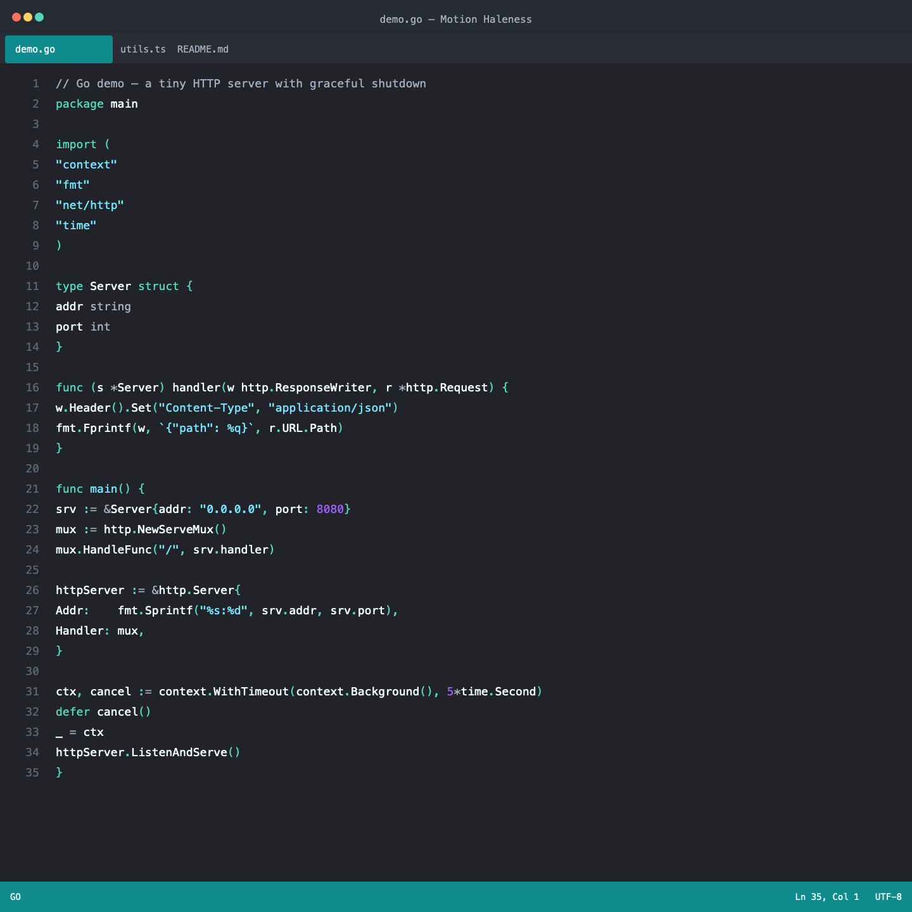
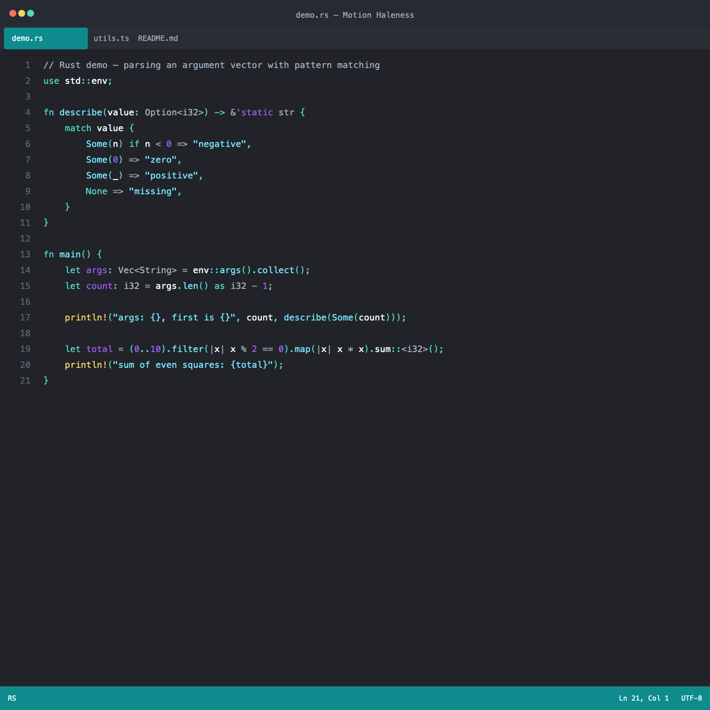
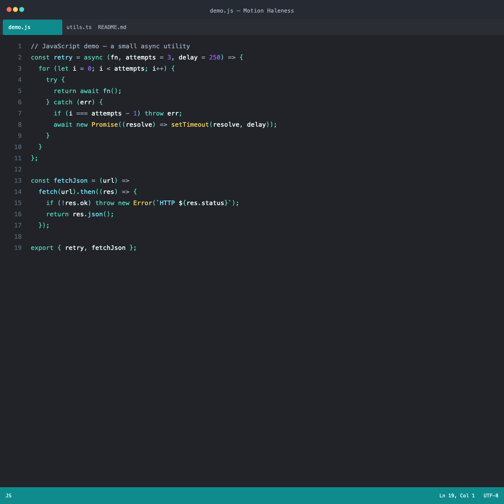
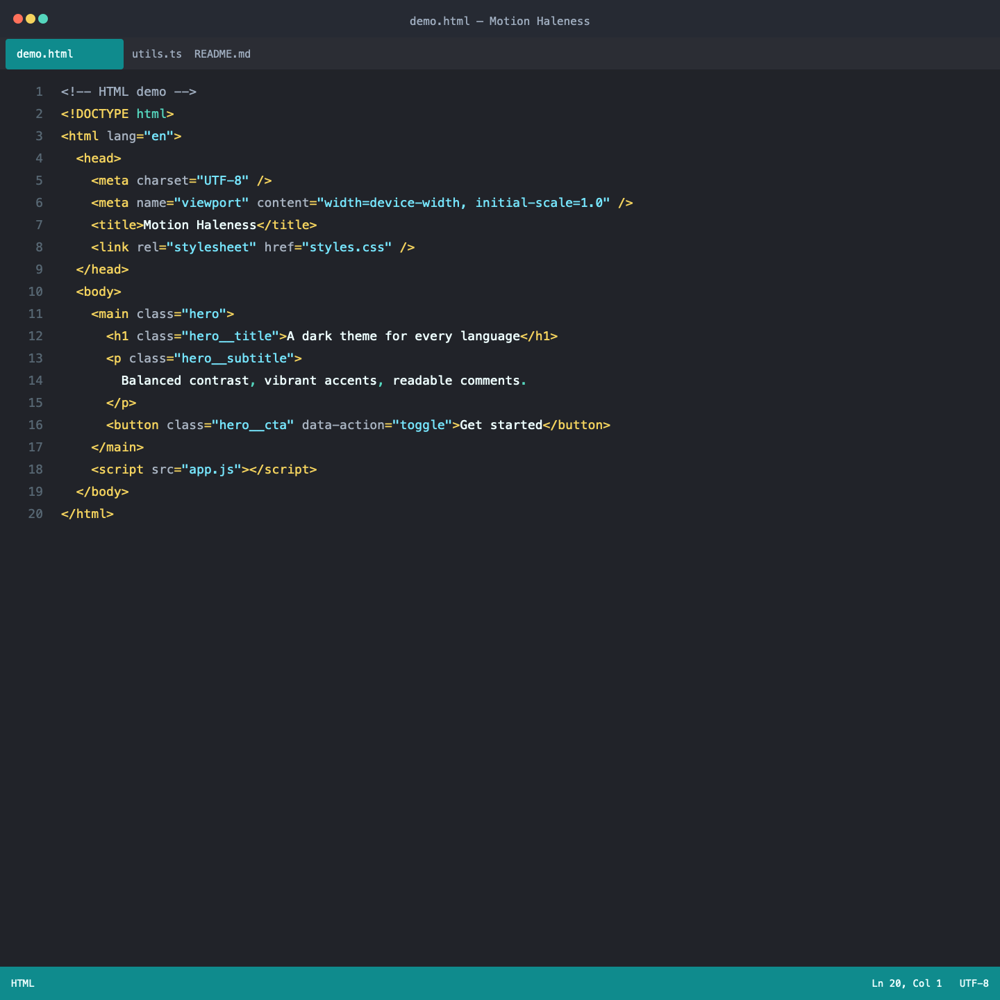
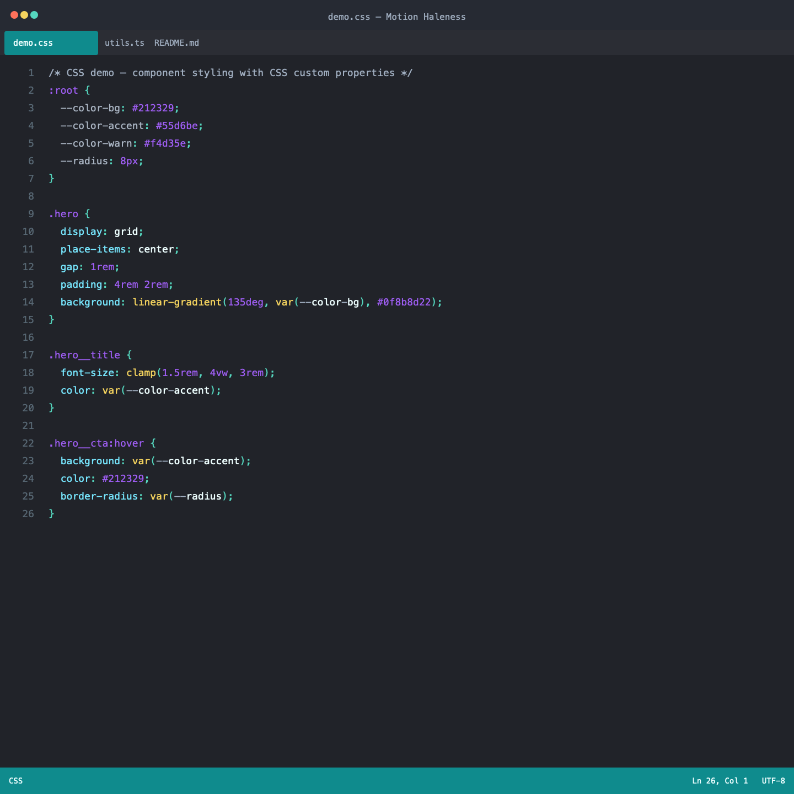
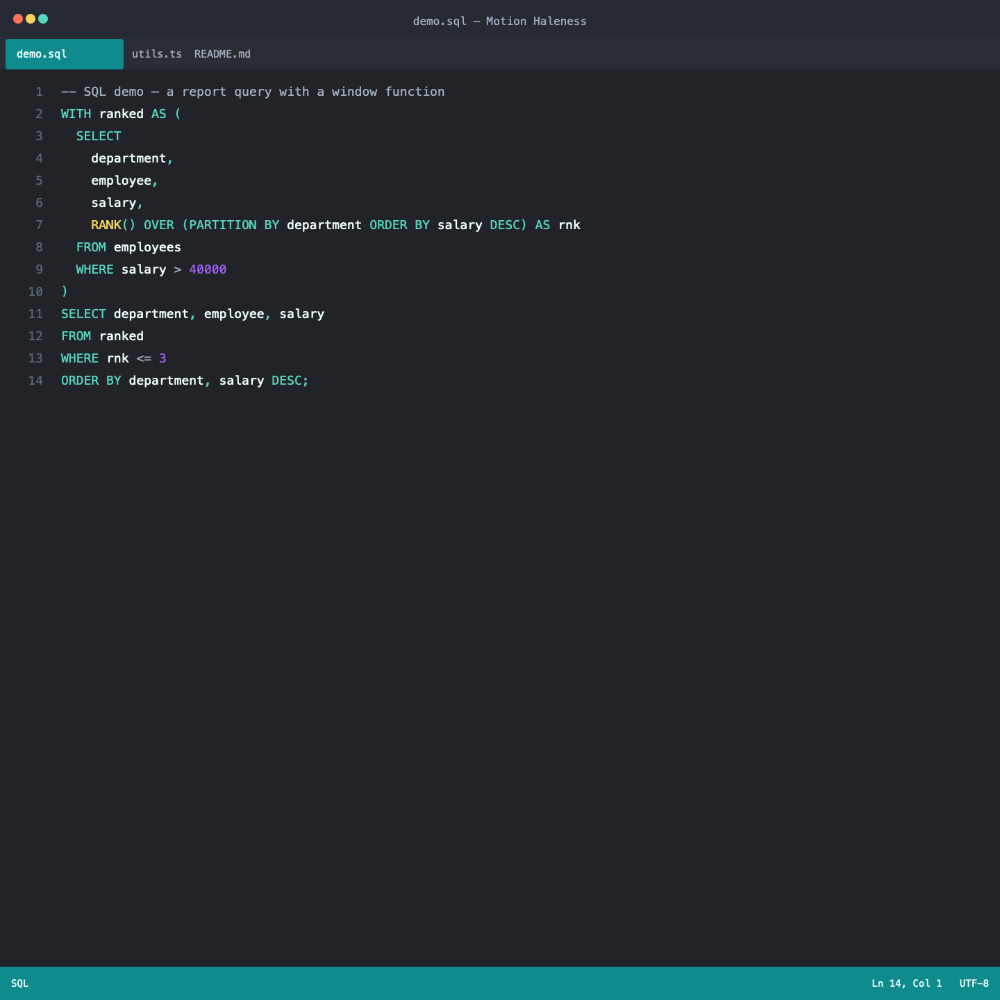

# Motion Haleness

A modern, high-contrast dark color theme for Visual Studio Code. Ready to install, ready to use and nothing to configure.

Motion Haleness is tuned for the way you code today. It pairs beautifully with AI coding agents like **Claude Code**, **Codex** and **Kilo Code**, with dedicated high-contrast chat colors that keep agent conversations easy to read. And because the palette is language-agnostic, your code looks consistent and balanced in TypeScript, React (TSX), JavaScript, Python, Go, Rust, HTML, CSS, SQL, and everything else your editor can parse.

## Features

- Optimized for AI coding agents: Claude Code, Codex and Kilo Code
- High-contrast chat, diff and Source Control colors
- Language-agnostic syntax highlighting for every language
- Semantic highlighting for TypeScript and JavaScript
- Themed terminal, bracket pairs and editor widgets
- Two variants: **Motion Haleness** and **Motion Haleness Italic**

## Screenshots

## Installation

1. Install **Motion Haleness** from the Visual Studio Code Marketplace
2. Open the Command Palette (`Ctrl+Shift+P`) → **Preferences: Color Theme**
3. Select **Motion Haleness** or **Motion Haleness Italic**

That's it.

## License

[MIT](LICENSE)
